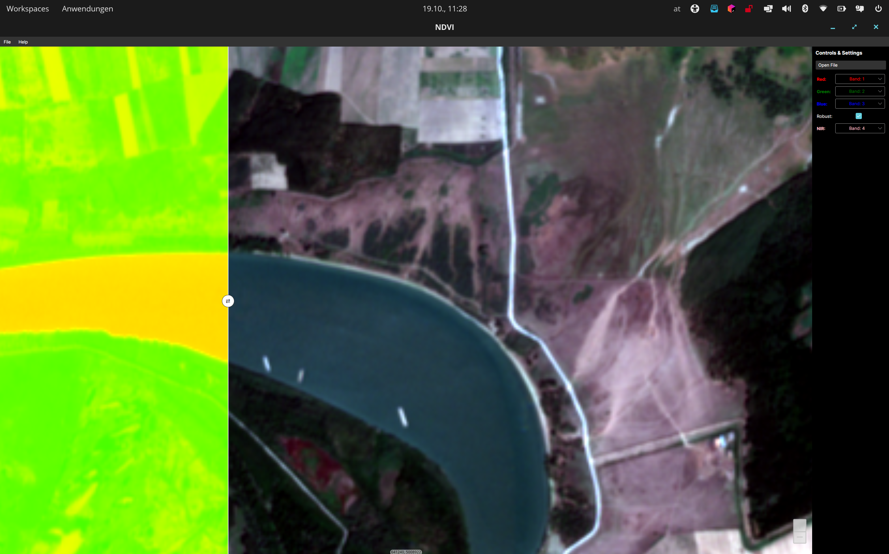

# NDVI Viewer

A desktop viewer for multispectral satellite imagery that computes and displays the **NDVI** (Normalized Difference Vegetation Index) side by side with a true- or false-colour composite. Pixel-heavy raster operations run as **GPU kernels written in C#** with ILGPU, with an automatic fallback from CUDA to OpenCL to CPU.

Built with **C# / .NET 9**, **Avalonia UI** (MVVM), **GDAL**, **ILGPU** and **Mapsui**.



## Features

- **Opens GeoTIFFs and Sentinel-2 SAFE products** through GDAL. For SAFE products, the 10 m, 20 m and 60 m subdatasets are merged into a single band index and resampled to a common grid.
- **Free band selection** for the R, G, B and NIR channels, so you can build true-colour or false-colour composites from any bands
- **NDVI map**: `(NIR − Red) / (NIR + Red)`, rendered with a colour ramp
- **Two synchronized map views** (Mapsui): pan, zoom and rotation in the composite view are mirrored in the NDVI view and vice versa
- **Contrast stretch**: plain min/max, or a **robust 2 % quantile stretch** that ignores outliers and NoData values
- **World file export** (`.tfw`) for georeferencing the rendered image

## GPU processing

All per-pixel work lives in `Models/BandProcessing.cs` and `Models/GpuPacker.cs` and runs as ILGPU kernels:

| Operation | Implementation |
|-----------|----------------|
| Band normalization to 8-bit | element-wise kernel with clamping |
| Min/max per band | parallel reduction using `Atomic.Min` / `Atomic.Max`, NoData-aware |
| Quantiles for the robust stretch | random sample (0.5 % of pixels) sorted with an ILGPU **radix sort**, then linear interpolation |
| NDVI | generic two-band map kernel, specialised through a struct implementing `IBandOperation` |
| RGBA packing | kernel that interleaves three bands into a BGRA bitmap buffer |

**Device selection:** at start-up the app picks a CUDA device if one is available, otherwise an OpenCL device, and otherwise the ILGPU CPU accelerator. The same code therefore runs on NVIDIA GPUs, AMD/Intel GPUs and machines without a GPU at all.

## Architecture

```
NDVI/
├── Program.cs / App.axaml            # Avalonia app setup, Fluent theme
├── Models/
│   ├── IRasterSource.cs              # Common interface for raster inputs
│   ├── GeoTiff.cs                    # GDAL-backed GeoTIFF source (+ world file export)
│   ├── SafeFile.cs                   # GDAL-backed Sentinel-2 SAFE source (10/20/60 m subdatasets)
│   ├── BandProcessing.cs             # ILGPU kernels: normalize, min/max, quantiles, NDVI
│   └── GpuPacker.cs                  # ILGPU kernel: R/G/B → BGRA bitmap
├── ViewModels/
│   └── MainWindowViewModel.cs        # Band selection, stretch mode, bitmap generation (CommunityToolkit.Mvvm)
└── Views/
    └── MainWindow.axaml(.cs)         # Two Mapsui map controls with synchronized viewports
```

- **MVVM** with CommunityToolkit.Mvvm source generators (`[ObservableProperty]`, `[RelayCommand]`)
- Raster sources sit behind the `IRasterSource` interface, so new formats can be added without touching the view model
- The view model raises an `ImageUpdated` event with the rendered bitmaps, the geotransform and the CRS. The view turns these into Mapsui raster layers.

## Tech stack

| Area | Technology |
|------|------------|
| Language / runtime | C#, .NET 9 |
| UI | Avalonia UI 11 (Fluent theme), CommunityToolkit.Mvvm |
| Maps | Mapsui (Avalonia) |
| Raster I/O | GDAL via MaxRev.Gdal.Core |
| GPU computing | ILGPU + ILGPU.Algorithms (CUDA, OpenCL, CPU) |

## Getting started

Requires the [.NET 9 SDK](https://dotnet.microsoft.com/download).

```bash
git clone https://github.com/raphi-web/NDVI.git
cd NDVI
dotnet run
```

Then open a GeoTIFF or a Sentinel-2 product (the `.SAFE` folder's `MTD_MSIL*.xml` metadata file) from the file dialog, and pick the bands for the composite and for NIR/Red.

> **Note:** the project currently references `MaxRev.Gdal.LinuxRuntime.Minimal`, so it runs on **Linux**. For Windows or macOS, add the matching MaxRev GDAL runtime package.

For GPU acceleration you need a CUDA or OpenCL driver. Without one, the app runs on the CPU accelerator.
